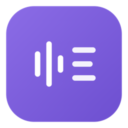
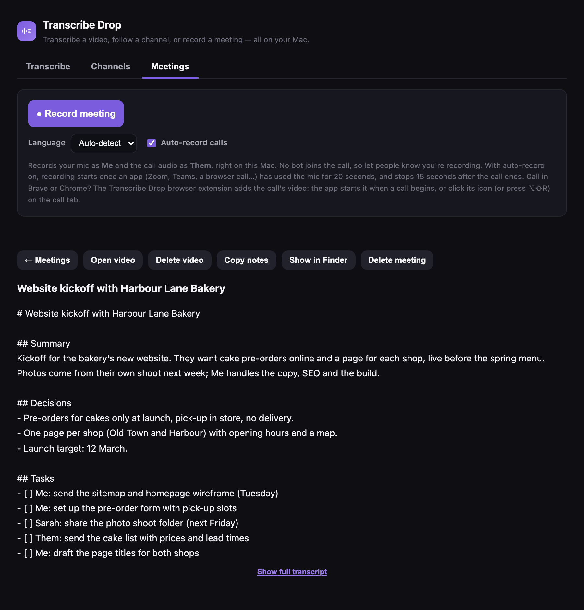

<div align="center">
  
  <h1>Transcribe Drop</h1>
  <p><b>Transcribe any video, or follow a YouTube channel and let AI tell you what's worth watching — all on your Mac.</b></p>
</div>



Transcription runs entirely on your machine (whisper.cpp) — no accounts, no per-minute charges, nothing leaves your Mac. The only optional online part is the AI summaries.

## What it does

- **Transcribe** any video or audio — paste a URL (YouTube, Facebook, …) or drop a file. Local, free, private.
- **Follow a YouTube channel** — it lists the latest videos, transcribes them (YouTube captions first, on-device Whisper as fallback), and shows them in a grid.
- **AI summaries** — click a video and Claude Haiku summarises it, tuned to a short "what I'm working on" context file, flagging what's **relevant to you** (the ✨). Summaries are generated on demand, so you only pay for what you actually open (~1¢ each, then cached).
- **Collections** — group pasted video/reel URLs (including Facebook reels) under any name you like.
- **Watch-later checklist** — star videos (☆) and check them off as you get through them.
- **Meetings**: record a call on this Mac (your mic and the call's sound), transcribe it on the Neural Engine with Me/Them labels, and get notes with decisions and tasks (needs an API key). Start and stop from the menu bar icon, or let it record by itself whenever a call holds the mic.

## Install (macOS)

You need macOS 15 or later (an Apple Silicon Mac for the Neural Engine), [Homebrew](https://brew.sh) and Xcode's command-line tools (`xcode-select --install`). In Terminal:

```sh
git clone https://github.com/djaysan/transcribe-drop.git
cd transcribe-drop
./make-signing-cert.sh
./install.sh
```

Then drag **Transcribe Drop.app** to your Applications folder.

- `make-signing-cert.sh` asks for your Mac password once. It creates a local signing certificate, so macOS keeps the Microphone and Screen Recording permissions every time you rebuild.
- `install.sh` installs `yt-dlp`, `ffmpeg` and `whisper-cpp`, builds whisper with Neural Engine support (meetings transcribe about twice as fast, without the fan) and builds the app. It takes a few minutes.
- On first launch the app downloads its meeting models in the background (about 1.8 GB, one time). The first meeting transcript takes about 5 minutes longer while macOS prepares the Neural Engine model; after that it's fast.
- When macOS asks, allow **Microphone**, **Screen Recording** (the call's sound) and **Accessibility** (starts the call video by itself).

To update: `git pull && ./install.sh`, then replace the app in Applications.

## Meeting video (Brave / Chrome, optional)

The Meetings tab records audio. To also keep the call's video (slides, shared screens), install the browser extension once:

1. Open `brave://extensions` (or `chrome://extensions`), switch on **Developer mode**, click **Load unpacked** and pick the `extension` folder.
2. Pin the Transcribe Drop icon to the toolbar.

On a call tab, click the icon or press **⌥⇧R**. This starts the meeting recording too, if it isn't already running. The icon shows **REC** while it records that tab's picture, even while you're on another tab. The video stops when the meeting does, and the meeting gets a `video.mp4` with the call audio, on the same timeline as the transcript. That's about 100–350 MB an hour. Browsers only let an extension record a tab after a click or its shortcut, so this one step stays manual.

## AI summaries (optional)

Open **⚙ Settings**, paste an [Anthropic API key](https://console.anthropic.com), and — optionally — pick a context file describing what you do (there's a built-in prompt to generate one with Claude). Without a key the app still lists and transcribes everything; it just skips the summaries. Everything except the summaries is free and local.

## Notes

- **Facebook:** individual reels work (paste them under ＋ Clips); following a whole FB profile isn't possible — its reels tab can't be listed.
- Your data (transcripts, settings, model) lives in `~/Library/Application Support/Transcribe Drop`, so the app is fully movable.
- Built with [yt-dlp](https://github.com/yt-dlp/yt-dlp) + [whisper.cpp](https://github.com/ggerganov/whisper.cpp) + [ffmpeg](https://ffmpeg.org) (transcription), Claude Haiku (summaries), and [pywebview](https://pywebview.flowrl.com) (UI).

## Run from source

Prefer not to build the app? Run it directly (Meetings won't record: they need the recorder that `install.sh` builds):

```sh
brew install yt-dlp ffmpeg whisper-cpp
pip install pywebview anthropic
python3 transcribe-app.py
```

## License

MIT — see [LICENSE](LICENSE).
